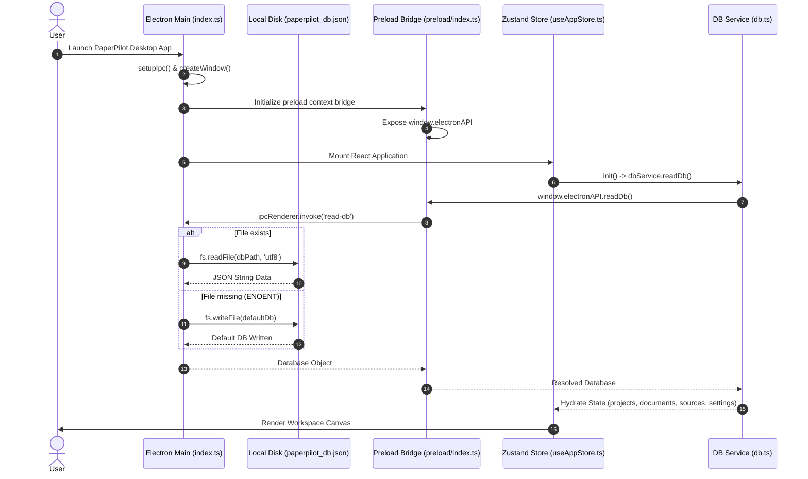
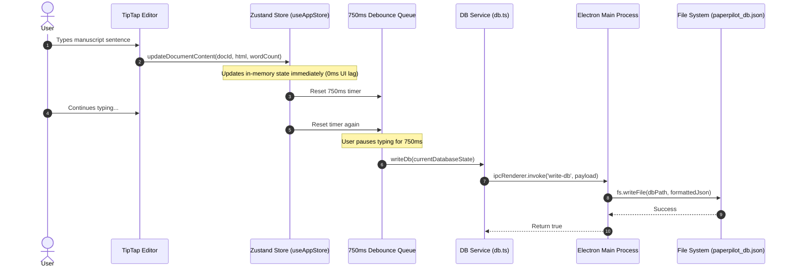
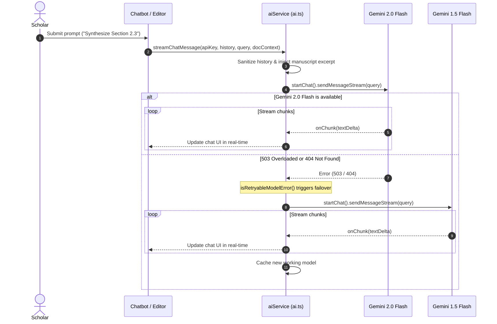
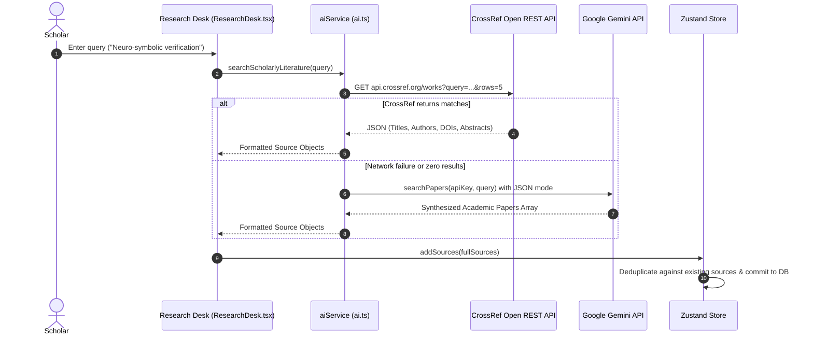
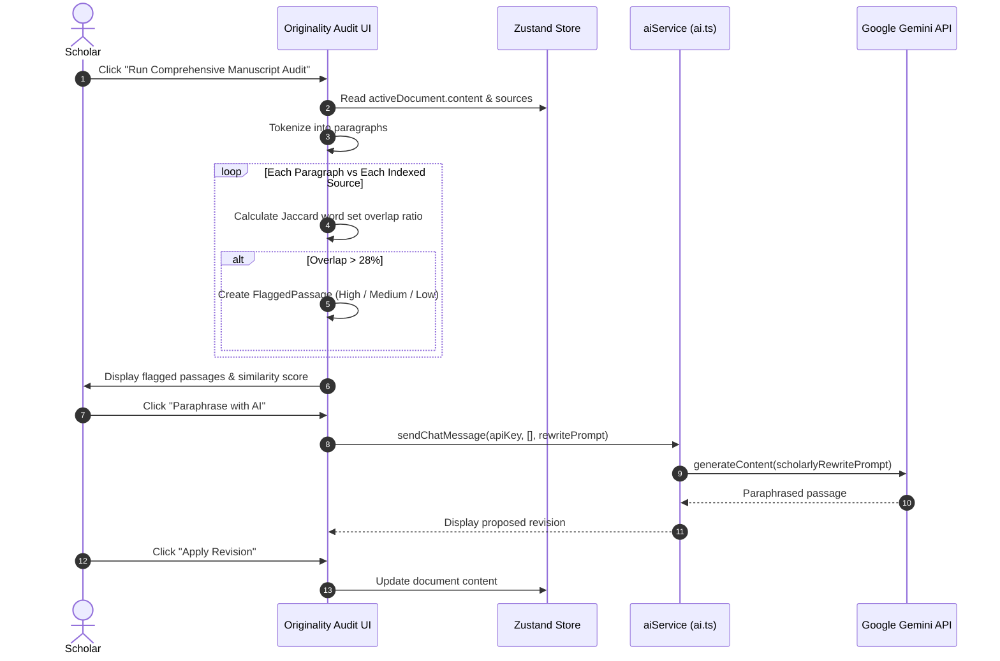

# Technical Report: PaperPilot Backend Architecture, Workflows & Library Reference

> **Document Version:** 1.0.0  
> **Target Application:** PaperPilot (AI-Powered Scholarly Writing Workstation)  
> **Generated:** October 2026  
> **Workspace Location:** `c:\Users\mishr\OneDrive\Desktop\paperpilot`

---

## Table of Contents
1. [Executive Architectural Overview](#1-executive-architectural-overview)
2. [Dual-Process Runtime & System Topology](#2-dual-process-runtime--system-topology)
3. [Deep Dive: Backend Subsystems](#3-deep-dive-backend-subsystems)
   - [3.1. Electron Main Process Backend](#31-electron-main-process-backend)
   - [3.2. Context-Isolated Preload Bridge](#32-context-isolated-preload-bridge)
   - [3.3. Persistence & Local JSON Database Engine](#33-persistence--local-json-database-engine)
   - [3.4. AI Intelligence & Model Orchestration Core](#34-ai-intelligence--model-orchestration-core)
   - [3.5. Academic Literature Ingestion Engine](#35-academic-literature-ingestion-engine)
   - [3.6. Originality & Literature Verification Engine](#36-originality--literature-verification-engine)
4. [Step-by-Step Workflows (with Mermaid Sequence Diagrams)](#4-step-by-step-workflows-with-mermaid-sequence-diagrams)
   - [Workflow 1: Application Bootstrapping & State Hydration](#workflow-1-application-bootstrapping--state-hydration)
   - [Workflow 2: Asynchronous Debounced Document Save Pipeline](#workflow-2-asynchronous-debounced-document-save-pipeline)
   - [Workflow 3: AI Co-Author Streaming & Automatic Model Failover](#workflow-3-ai-co-author-streaming--automatic-model-failover)
   - [Workflow 4: Academic Literature Search & Citation Ingestion](#workflow-4-academic-literature-search--citation-ingestion)
   - [Workflow 5: Originality Audit & Scholarly Paraphrasing](#workflow-5-originality-audit--scholarly-paraphrasing)
5. [Complete Library & Dependency Catalog (Definitions & Roles)](#5-complete-library--dependency-catalog-definitions--roles)
   - [5.1. Desktop Runtime & Build Backend](#51-desktop-runtime--build-backend)
   - [5.2. Artificial Intelligence & Cloud Services](#52-artificial-intelligence--cloud-services)
   - [5.3. State Management & Storage](#53-state-management--storage)
   - [5.4. Document Processing & ProseMirror Engine (TipTap)](#54-document-processing--prosemirror-engine-tiptap)
   - [5.5. Frontend Framework, Routing & UI Utilities](#55-frontend-framework-routing--ui-utilities)
   - [5.6. Development & Compilation Tooling](#56-development--compilation-tooling)
6. [Security, Performance & Offline-First Guarantees](#6-security-performance--offline-first-guarantees)

---

## 1. Executive Architectural Overview

**PaperPilot** is an **offline-first, AI-augmented academic writing workstation** designed for researchers, faculty, and graduate scholars. 

Rather than relying on a conventional remote client-server web backend (such as Express, Django, or Spring Boot) which would require sending private manuscript drafts to third-party databases, PaperPilot employs a **hybrid local/cloud desktop architecture**:

1. **Local Desktop Backend (Electron Node.js Runtime)**:
   - Executes directly on the user's workstation.
   - Manages OS-level security boundaries, window lifecycles, and atomic file-system writes to a local JSON document database (`paperpilot_db.json`).
   - Ensures manuscripts remain private and fully functional even when disconnected from the internet.
2. **Context-Isolated Preload Bridge**:
   - Bridges the Chromium UI rendering process and the Node.js backend.
   - Restricts renderer privileges using `contextIsolation: true` and `nodeIntegration: false`, exposing strictly typed IPC methods (`readDb`, `writeDb`, window management).
3. **External AI & Open Scholarly Backend Services**:
   - **Google Gemini API** (via `@google/generative-ai` SDK and Google's REST endpoints): Powers generative synthesis, real-time token streaming, academic citation drafting, and context-aware revisions.
   - **CrossRef Open REST API** (`api.crossref.org`): Provides real-time metadata queries across 150M+ peer-reviewed papers, extracting DOIs, authors, journals, publication dates, and abstracts without credential friction.

---

## 2. Dual-Process Runtime & System Topology

```
┌────────────────────────────────────────────────────────────────────────┐
│                        CHROMIUM RENDERER PROCESS                       │
│  ┌─────────────────────────┐  ┌───────────────┐  ┌──────────────────┐  │
│  │ React 18 UI / Workspace │  │ TipTap Editor │  │ Zustand Store    │  │
│  └───────────┬─────────────┘  └───────┬───────┘  └────────┬─────────┘  │
└──────────────┼────────────────────────┼───────────────────┼────────────┘
               │                        │                   │
               ▼                        ▼                   ▼
┌────────────────────────────────────────────────────────────────────────┐
│       ISOLATED CONTEXT BRIDGE & SERVICES (src/services/ai.ts & db.ts)   │
│       • window.electronAPI (IPC Invoke Channel)                         │
│       • Direct HTTPS fetch to CrossRef REST API                         │
│       • Gemini SDK Client & Model Orchestration                         │
└──────────────────────┬──────────────────────┬──────────────────────────┘
                       │                      │
      IPC (read-db / write-db)                │ HTTPS (API Keys, JSON, Streams)
                       ▼                      ▼
┌──────────────────────────────────┐ ┌───────────────────────────────────┐
│  ELECTRON MAIN NODE.JS BACKEND   │ │      EXTERNAL CLOUD SERVICES      │
│  (electron/main/index.ts)        │ │                                   │
│  • File System I/O (fs/promises) │ │ • Google Generative Language API  │
│  • OS Path Resolution (userData) │ │   (Gemini 2.0 Flash / Pro)        │
│  • Local JSON Document Database  │ │                                   │
│  • Window Lifecycle & Security   │ │ • CrossRef Open REST API          │
│  • OS Shell External Link Proxy  │ │   (150M+ Academic Papers)         │
└──────────────────────────────────┘ └───────────────────────────────────┘
```

---

## 3. Deep Dive: Backend Subsystems

### 3.1. Electron Main Process Backend
* **File:** [`electron/main/index.ts`](file:///c:/Users/mishr/OneDrive/Desktop/paperpilot/electron/main/index.ts)
* **Runtime:** Node.js v20+ within Electron v33.

#### Core Responsibilities:
1. **Window Management & Dev/Prod Loading**:
   - Spawns the main `BrowserWindow` (1400x900 resolution).
   - In development mode (`NODE_ENV === 'development'`), connects directly to Vite's HMR dev server URL (`VITE_DEV_SERVER_URL`).
   - In production builds, loads the compiled HTML payload from `dist/index.html`.
2. **Security Hardening**:
   - `contextIsolation: true`: Prevents renderer scripts from modifying Node.js prototypes or accessing internal APIs.
   - `nodeIntegration: false`: Denies the renderer direct access to `require()`, `child_process`, or raw POSIX bindings.
   - `setWindowOpenHandler`: Traps external navigation requests (`http:`, `https:`). Rather than allowing arbitrary browser popups inside Electron, links are forwarded to the host operating system's default browser via `shell.openExternal(url)`, with internal window spawning denied.
3. **Database File System Engine**:
   - Resolves the OS user data directory via `app.getPath('userData')`.
   - Targets the database file at `join(userDataPath, 'paperpilot_db.json')`.
   - On initialization, checks for file existence. If missing (`ENOENT`), it generates an initial default database payload:
     ```json
     { "projects": [], "documents": [], "sources": [], "settings": {} }
     ```
4. **IPC Handlers**:
   - `ipcMain.handle('read-db')`: Asynchronously reads and parses the JSON file using Node's `fs/promises`.
   - `ipcMain.handle('write-db', (_, data))`: Formats and writes the entire application state back to disk with 2-space indentation.
   - `ipcMain.handle('minimize-window')`: Minimizes the active window.
   - `ipcMain.handle('maximize-window')`: Toggles window maximize/unmaximize.
   - `ipcMain.handle('close-window')`: Gracefully closes the window and terminates processes.

---

### 3.2. Context-Isolated Preload Bridge
* **File:** [`electron/preload/index.ts`](file:///c:/Users/mishr/OneDrive/Desktop/paperpilot/electron/preload/index.ts)

Acts as the security firewall between the untrusted renderer and privileged Node backend:

```typescript
import { contextBridge, ipcRenderer } from 'electron';

contextBridge.exposeInMainWorld('electronAPI', {
  readDb: () => ipcRenderer.invoke('read-db'),
  writeDb: (data: any) => ipcRenderer.invoke('write-db', data),
  minimize: () => ipcRenderer.invoke('minimize-window'),
  maximize: () => ipcRenderer.invoke('maximize-window'),
  close: () => ipcRenderer.invoke('close-window'),
});
```

---

### 3.3. Persistence & Local JSON Database Engine
* **Files:** [`src/services/db.ts`](file:///c:/Users/mishr/OneDrive/Desktop/paperpilot/src/services/db.ts) and [`src/store/useAppStore.ts`](file:///c:/Users/mishr/OneDrive/Desktop/paperpilot/src/store/useAppStore.ts)

#### Relational Data Schema:
* **`Project`**:
  ```typescript
  export interface Project {
    id: string;
    title: string;
    description: string;
    template?: string; // e.g., 'IEEE Transactions', 'Nature Conference', 'NIH Grant'
    createdAt: string;
    updatedAt: string;
  }
  ```
* **`Document`**:
  ```typescript
  export interface Document {
    id: string;
    projectId: string;
    title: string;
    content: string; // TipTap HTML / ProseMirror JSON tree
    wordCount: number;
    createdAt: string;
    updatedAt: string;
  }
  ```
* **`Source`**:
  ```typescript
  export interface Source {
    id: string;
    projectId: string;
    title: string;
    authors: string;
    publication: string;
    publishedAt: string;
    url: string;
    doi: string;
    abstract: string;
    snippet: string;
    accessedAt: string;
    notes: string;
    semanticMatch?: string;
    tag?: string;
  }
  ```
* **`Settings`**:
  ```typescript
  export interface Database {
    projects: Project[];
    documents: Document[];
    sources: Source[];
    settings: {
      geminiKey?: string;
      searchKey?: string;
      similarityInterval?: number;
      autoCheckEnabled?: boolean;
      citationStyle?: string;
      theme?: string;
      activeModel?: string;
      speedMode?: 'turbo' | 'balanced' | 'deep';
    };
  }
  ```

#### Debounced Disk I/O Pipeline:
Typing in a rich text editor dispatches frequent change notifications. Direct file-system writes on every keystroke would thrash the disk and degrade typing responsiveness. 

PaperPilot resolves this with a **750ms Debounced Storage Queue** in [`useAppStore.ts`](file:///c:/Users/mishr/OneDrive/Desktop/paperpilot/src/store/useAppStore.ts#L54-L71):
1. In-memory Zustand state updates instantly (0ms latency for smooth UI rendering).
2. The asynchronous `debouncedWriteDb` timer resets.
3. When typing pauses for 750ms, all pending save callbacks resolve and the state is flushed to disk via `dbService.writeDb`.
4. If run in a standard web browser (outside Electron), `dbService` seamlessly falls back to browser `localStorage`.

---

### 3.4. AI Intelligence & Model Orchestration Core
* **File:** [`src/services/ai.ts`](file:///c:/Users/mishr/OneDrive/Desktop/paperpilot/src/services/ai.ts)

Provides a resilient abstraction layer over Google's generative models:

1. **Auto-Discovery & Dynamic Model Catalog**:
   - `getAvailableModels(apiKey)`: Queries Google's REST endpoint (`https://generativelanguage.googleapis.com/v1beta/models`) using the user's API key.
   - Automatically filters models supporting `generateContent` and prioritizes stable production releases (`gemini-2.0-flash` > `gemini-1.5-flash` > `gemini-2.5-flash`).
2. **Transparent Error Detection & Failover (`isRetryableModelError`)**:
   - Detects HTTP `404` (model retired), `503` (high demand / overloaded), `RESOURCE_EXHAUSTED` (rate limits), and `UNAVAILABLE`.
   - Iterates through a fallback sequence (`gemini-2.0-flash`, `gemini-2.0-flash-lite`, `gemini-1.5-flash`, `gemini-1.5-pro`) without terminating the user's session.
3. **Manuscript Context Extraction & History Sanitization**:
   - Extracts plain text from the active document, removes HTML tags, and passes up to 1,500 characters of the manuscript draft directly into the model's `systemInstruction`.
   - Enforces Gemini's turn requirements: filters error bubbles, ensures the conversation begins with role `user`, ensures roles alternate strictly between `user` and `model`, and limits history to the last 8 turns for rapid inference.
4. **Streaming & Synchronous Execution**:
   - `streamChatMessage`: Calls `sendMessageStream`, pumping tokens to the UI via an `onChunk` callback.
   - `sendChatMessage`: Standard multi-turn request/response pipeline.
   - `searchPapers`: Generates structured academic citations using Gemini's native JSON mode (`responseMimeType: 'application/json'`).
   - `testLatency`: Benchmarks real-world API latency in milliseconds.

---

### 3.5. Academic Literature Ingestion Engine
* **File:** [`src/services/ai.ts`](file:///c:/Users/mishr/OneDrive/Desktop/paperpilot/src/services/ai.ts#L448-L503) & [`src/components/research/ResearchDesk.tsx`](file:///c:/Users/mishr/OneDrive/Desktop/paperpilot/src/components/research/ResearchDesk.tsx)

PaperPilot features a zero-friction academic search mechanism:
1. **Primary Provider (CrossRef Open REST API)**:
   - Queries `https://api.crossref.org/works?query=<query>&rows=5&select=DOI,title,author,published,publisher,container-title,abstract`.
   - Free, unauthenticated, and grants access to over 150 million registered DOI works.
   - Parses author arrays, formats publication years, journals, and strips XML/HTML from abstracts.
2. **Secondary Fallback (Gemini Bibliographic Synthesis)**:
   - If CrossRef is unreachable or the user requests esoteric topics, Gemini synthesizes literature entries formatted as structured JSON with matching DOIs and abstracts.
3. **Citation Formatting**:
   - Generates standardized citation handles (e.g., `[Rostova et al., 2024]`) and injects them directly into the manuscript cursor location.

---

### 3.6. Originality & Literature Verification Engine
* **File:** [`src/components/originality/OriginalityReport.tsx`](file:///c:/Users/mishr/OneDrive/Desktop/paperpilot/src/components/originality/OriginalityReport.tsx)

Allows scholars to verify manuscript originality locally before submitting for peer review:
1. **Paragraph Segmentation**: Slices the manuscript into discrete paragraph blocks.
2. **N-Gram Lexical Extraction**: Generates word frequency sets (filtering terms shorter than 4 characters) and compares them against the project's indexed sources.
3. **Jaccard Overlap Matrix**:
   $$\text{Overlap Ratio} = \frac{|W_{\text{manuscript}} \cap W_{\text{source}}|}{|W_{\text{manuscript}}|}$$
4. **Severity Tiers**:
   - **High (>70%)**: Flagged as verbatim alignment; prompts quotation mark insertion or structural rewrite.
   - **Medium (50%–70%)**: Flagged as high conceptual phrasing overlap; prompts citation attribution.
   - **Low (<50%)**: Common academic phrasing / boilerplate.
5. **AI Scholarly Paraphrasing**:
   - Sends flagged excerpts to Gemini with prompts designed to eliminate verbatim overlap while strictly maintaining empirical and mathematical accuracy.

---

## 4. Step-by-Step Workflows (with Mermaid Sequence Diagrams)

### Workflow 1: Application Bootstrapping & State Hydration



---

### Workflow 2: Asynchronous Debounced Document Save Pipeline



---

### Workflow 3: AI Co-Author Streaming & Automatic Model Failover



---

### Workflow 4: Academic Literature Search & Citation Ingestion



---

### Workflow 5: Originality Audit & Scholarly Paraphrasing



---

## 5. Complete Library & Dependency Catalog (Definitions & Roles)

Every dependency and devDependency from [`package.json`](file:///c:/Users/mishr/OneDrive/Desktop/paperpilot/package.json) is cataloged below with its version, category, technical definition, and architectural role.

### 5.1. Desktop Runtime & Build Backend

| Library | Version | Category | Technical Definition & Architectural Role |
| :--- | :--- | :--- | :--- |
| **`electron`** | `^33.0.2` | Runtime Backend | **Definition:** An open-source framework combining Chromium (rendering) and Node.js (system runtime) into a single cross-platform desktop executable.<br>**Role in PaperPilot:** Hosts the application, provides the desktop window, and runs the local persistence backend. |
| **`vite-plugin-electron`** | `*` | Build Tooling | **Definition:** A Vite plugin that provides seamless integration between Vite's ES module bundler and Electron's dual-process architecture.<br>**Role in PaperPilot:** Compiles `electron/main/index.ts` and `electron/preload/index.ts` into `dist-electron/` and handles hot restart during development. |
| **`vite-plugin-electron-renderer`** | `*` | Build Tooling | **Definition:** Companion plugin to `vite-plugin-electron` that configures module resolution so the renderer can interface with Electron APIs.<br>**Role in PaperPilot:** Coordinates inter-process module linking and polyfills native Node externals during build. |
| **`electron-builder`** | `^25.1.8` | Packaging & Distribution | **Definition:** A complete desktop packaging solution that builds installable executables (NSIS `.exe` on Windows, `.dmg` on macOS, `.AppImage` on Linux).<br>**Role in PaperPilot:** Packages compiled React assets and Electron scripts into the `release/` folder. |

---

### 5.2. Artificial Intelligence & Cloud Services

| Library | Version | Category | Technical Definition & Architectural Role |
| :--- | :--- | :--- | :--- |
| **`@google/generative-ai`** | `^0.21.0` | Cloud AI SDK | **Definition:** Google's official client SDK for interacting with Gemini models via Google AI Studio / Vertex AI.<br>**Role in PaperPilot:** Powers AI chat assistance, token streaming (`sendMessageStream`), structured JSON paper synthesis (`responseMimeType: 'application/json'`), and academic paraphrasing. |

---

### 5.3. State Management & Storage

| Library | Version | Category | Technical Definition & Architectural Role |
| :--- | :--- | :--- | :--- |
| **`zustand`** | `^5.0.0` | State Engine | **Definition:** A small, fast, unopinionated state-management library based on simplified flux principles and React hooks.<br>**Role in PaperPilot:** Serves as the single source of truth (`useAppStore.ts`) for projects, open documents, active citations, UI themes, and editor instances. |

---

### 5.4. Document Processing & ProseMirror Engine (TipTap)

| Library | Version | Category | Technical Definition & Architectural Role |
| :--- | :--- | :--- | :--- |
| **`@tiptap/pm`** | `^2.10.2` | Core Engine | **Definition:** ProseMirror's low-level modules bundled for TipTap, providing an immutable document model, transactions, and DOM serialization.<br>**Role in PaperPilot:** Enforces strict document schemas and manages transactional undo/redo history. |
| **`@tiptap/react`** | `^2.10.2` | UI Binding | **Definition:** React components and hooks (`useEditor`, `EditorContent`) that bridge ProseMirror's state machine with React's virtual DOM.<br>**Role in PaperPilot:** Mounts and controls the manuscript writing canvas in `Editor.tsx`. |
| **`@tiptap/starter-kit`** | `^2.10.2` | Extension Suite | **Definition:** A curated bundle of essential rich-text extensions (Bold, Italic, Strike, Code, Heading, Lists, Blockquote, History).<br>**Role in PaperPilot:** Provides standard manuscript markup capabilities out of the box. |
| **`@tiptap/extension-document`** | `^2.10.2` | Schema Node | **Definition:** The top-level root node in the ProseMirror schema tree.<br>**Role in PaperPilot:** Enforces structural document hierarchy. |
| **`@tiptap/extension-paragraph`** | `^2.10.2` | Schema Node | **Definition:** Represents standard block paragraphs (`<p>`).<br>**Role in PaperPilot:** Primary structural unit used during originality audits to test text against indexed sources. |
| **`@tiptap/extension-text`** | `^2.10.2` | Schema Node | **Definition:** The fundamental inline text leaf node in ProseMirror.<br>**Role in PaperPilot:** Holds all typed manuscript characters and glyphs. |
| **`@tiptap/extension-text-style`** | `^2.10.2` | Schema Mark | **Definition:** Extension that allows custom inline CSS spans and styling properties (e.g., font families, colors).<br>**Role in PaperPilot:** Enables scholarly font changes and styling in the ribbon bar. |
| **`@tiptap/extension-text-align`** | `^2.27.3` | Schema Attribute | **Definition:** Allows left, center, right, and justified alignment across block nodes.<br>**Role in PaperPilot:** Required for formatting academic papers (e.g., justified columns in IEEE format). |
| **`@tiptap/extension-color`** | `^2.10.2` | Schema Mark | **Definition:** Adds color styling (`style="color: ..."`) to text selections.<br>**Role in PaperPilot:** Used for reviewer markup and text annotations. |
| **`@tiptap/extension-highlight`** | `^2.10.2` | Schema Mark | **Definition:** Wraps text in `<mark>` elements with configurable background fills.<br>**Role in PaperPilot:** Highlights flagged passages during originality audits and AI verification reviews. |
| **`@tiptap/extension-link`** | `^2.10.2` | Schema Mark | **Definition:** Parses and renders clickable hyperlinks (`<a>`).<br>**Role in PaperPilot:** Formats active DOI URLs and research paper references. |
| **`@tiptap/extension-underline`** | `^2.27.3` | Schema Mark | **Definition:** Adds `<u>` text underlines.<br>**Role in PaperPilot:** Standard document formatting control in the Ribbon. |
| **`@tiptap/extension-subscript`** | `^2.27.3` | Schema Mark | **Definition:** Renders subscript elements (`<sub>`).<br>**Role in PaperPilot:** Essential for scientific writing (chemical formulas, mathematical indices). |
| **`@tiptap/extension-superscript`** | `^2.27.3` | Schema Mark | **Definition:** Renders superscript elements (`<sup>`).<br>**Role in PaperPilot:** Crucial for academic citations (e.g., `Nature` style `[1]`), mathematical exponents, and author affiliations. |
| **`@tiptap/extension-task-list` & `task-item`** | `^2.10.2` | Interactive Nodes | **Definition:** Adds interactive checklist blocks with checkboxes.<br>**Role in PaperPilot:** Powers research checklists, peer-review todo lists, and revision milestones. |
| **`@tiptap/extension-typography`** | `^2.10.2` | Input Rule | **Definition:** Automatically converts ASCII sequences into proper typographical glyphs (e.g., `-->` to `→`, `...` to `…`, `(c)` to `©`, quotes to curly quotes).<br>**Role in PaperPilot:** Ensures high publication standards for typesetting. |
| **`@tiptap/extension-placeholder`** | `^2.10.2` | UI Decoration | **Definition:** Injects CSS placeholder text when nodes or documents are empty.<br>**Role in PaperPilot:** Displays helpful prompts (e.g., *"Start drafting your manuscript..."*) in empty sections. |

---

### 5.5. Frontend Framework, Routing & UI Utilities

| Library | Version | Category | Technical Definition & Architectural Role |
| :--- | :--- | :--- | :--- |
| **`react` & `react-dom`** | `^18.3.1` | UI Library | **Definition:** Declarative component-based UI library using fiber reconciliation and concurrent rendering.<br>**Role in PaperPilot:** Renders all panels, ribbons, modals, and views. |
| **`react-router-dom`** | `^6.27.0` | Routing | **Definition:** Declarative routing library for React web applications.<br>**Role in PaperPilot:** Manages view states and deep navigation across the workstation. |
| **`lucide-react`** | `^0.453.0` | Iconography | **Definition:** A clean, consistent icon library containing hundreds of vector icons.<br>**Role in PaperPilot:** Provides all icons used throughout the Ribbon, Sidebar, and Research Desk. |
| **`tailwind-merge`** | `^2.5.4` | Styling Utility | **Definition:** Utility function that merges Tailwind CSS classes in JS without CSS specificity conflicts.<br>**Role in PaperPilot:** Ensures dynamic style classes in UI components override base styles deterministically. |
| **`tailwindcss`** | `^3.4.14` | Styling Engine | **Definition:** A utility-first CSS framework providing granular styling classes compiled into optimized CSS.<br>**Role in PaperPilot:** Defines the design system, dark mode variants, and responsive layout. |
| **`postcss` & `autoprefixer`** | `^8.4.47` / `^10.4.20` | CSS Build Tools | **Definition:** PostCSS transforms CSS with JS plugins; Autoprefixer automatically adds vendor prefixes to CSS rules.<br>**Role in PaperPilot:** Compiles and standardizes CSS for the embedded Chromium browser engine. |

---

### 5.6. Development & Compilation Tooling

| Library | Version | Category | Technical Definition & Architectural Role |
| :--- | :--- | :--- | :--- |
| **`vite`** | `^5.4.10` | Bundler & Dev Server | **Definition:** Next-generation frontend build tool providing an instantaneous development server via native ES modules and Rollup-based production builds.<br>**Role in PaperPilot:** Orchestrates development bundling, hot module replacement (HMR), and builds both the renderer and Electron bundles. |
| **`@vitejs/plugin-react`** | `^4.3.3` | Vite Plugin | **Definition:** Official Vite plugin for React providing Fast Refresh and JSX transformation via Babel.<br>**Role in PaperPilot:** Enables near-instant UI refresh during development. |
| **`typescript`** | `~5.6.2` | Language & Compiler | **Definition:** Strongly typed superset of JavaScript developed by Microsoft that compiles to clean JavaScript.<br>**Role in PaperPilot:** Provides strict type safety across all database models, API payloads, and IPC interfaces. |
| **`@types/node`** | `^22.8.2` | Type Definitions | **Definition:** TypeScript definitions for Node.js standard library modules (`path`, `fs`, `process`).<br>**Role in PaperPilot:** Type-checks Electron main scripts and file operations. |
| **`@types/react` & `@types/react-dom`** | `^18.3.12` / `^18.3.1` | Type Definitions | **Definition:** TypeScript definitions for React elements, hooks, and DOM nodes.<br>**Role in PaperPilot:** Enforces component prop types and lifecycle contracts. |

---

## 6. Security, Performance & Offline-First Guarantees

1. **Context Isolation & Sandboxing**:
   The renderer process cannot execute unauthorized Node.js commands. All file I/O operations are funneled through explicit IPC channels (`read-db`, `write-db`) in the main process.
2. **Debounced Disk Writes**:
   Writing to disk with a 750ms debounce prevents storage thrashing during typing sessions while keeping memory and disk in sync.
3. **API Key Security**:
   The user's Google Gemini API key is stored locally in the user's `paperpilot_db.json` and in memory—never sent to an intermediary server.
4. **Resilient AI Pipeline**:
   Automatic detection of retryable errors (404s, 503s, rate limits) ensures that high demand or transient API failures failover to available backup models without interrupting the user.
5. **Zero-Credential Academic Ingestion**:
   Direct integration with CrossRef enables discovery across 150M+ open scholarly papers without requiring an external API key or paid subscription.

---
*Report compiled for the PaperPilot academic engineering workspace.*
